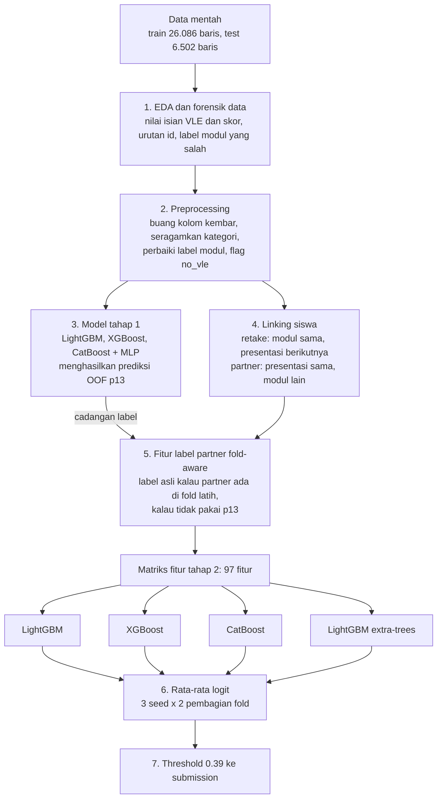

# DSCO Olympiads 2026: Prediksi Siswa At-Risk

Solusi tim **seamen** untuk kompetisi DSCO Olympiads 2026: menebak siswa yang berisiko gagal atau mundur (`at_risk`) dari data 4 minggu pertama perkuliahan (demografi, nilai tugas, dan aktivitas di platform belajar online / VLE).

| | |
|---|---|
| Metrik | F1 kelas positif (`at_risk = 1`) |
| F1 cross-validation | 0.7793 (AUC 0.8525) |
| Public leaderboard | 0.79071 |
| Hasil akhir | **Peringkat 13** di private leaderboard |

Semua langkah ada di satu notebook: [`final_notebook_exp30.ipynb`](final_notebook_exp30.ipynb) (EDA, preprocessing, model selection, evaluasi, training final, dan submission).

## Alur approach



### Ide utama

- **Forensik data.** Sekitar 14% baris punya data VLE isian (semua kolom VLE bernilai sama persis) dan 95% di antaranya at-risk. Siswa tanpa nilai diisi `avg_score = 77`. Sebanyak 145 baris di train punya label modul yang salah dan kami perbaiki ke M07.
- **Linking siswa.** Data tidak punya id siswa, tapi satu siswa bisa muncul di beberapa baris. Kami mencocokkan baris lewat demografi yang sama persis. Posisi `id` di dalam blok modul×presentasi dipakai sebagai bobot kemiripan, karena `id` urut per siswa.
  - *Retake:* siswa yang punya baris lagi di presentasi berikutnya dengan `num_of_prev_attempts + 1` ternyata 78,5% at-risk (rata-rata 52,7%).
  - *Partner:* siswa yang mengambil modul lain di presentasi yang sama. Label kedua baris berkorelasi 0,36.
- **Fitur label tanpa kebocoran.** Label partner hanya dipakai kalau partner ada di fold latih. Kalau tidak, dipakai prediksi out-of-fold dari model tahap 1. Fitur ini dibuat ulang di setiap fold.
- **Validasi.** Kami memakai 5-fold × 3 repeat dengan fold yang sama untuk semua kandidat. Hyperparameter Optuna dicari di fold terpisah, dan pilihan akhir dikonfirmasi di fold baru. Submission final dipilih berdasarkan CV, bukan public leaderboard.

### Hasil model selection (CV)

| Kandidat | AUC | F1 maks | Threshold |
|---|---|---|---|
| Tahap 1 (tree + MLP) | 0.8479 | 0.7757 | 0.360 |
| LightGBM tanpa fitur linking | 0.8469 | 0.7750 | 0.370 |
| LightGBM | 0.8514 | 0.7782 | 0.385 |
| XGBoost | 0.8516 | 0.7788 | 0.385 |
| CatBoost | 0.8495 | 0.7778 | 0.400 |
| **LGBM + XGB + Cat + ET (dipilih)** | **0.8525** | **0.7793** | **0.390** |

Fitur linking siswa menaikkan F1 sekitar +0.003, lebih besar dari efek ganti model atau tuning.

## Cara menjalankan

1. Unduh `train.csv`, `test.csv`, dan `sample_submission.csv` dari halaman kompetisi, lalu taruh di folder yang sama dengan notebook. Data tidak disertakan di repo ini karena mengikuti aturan kompetisi.
2. Install dependensi (diuji dengan Python 3.12):

   ```bash
   pip install -r requirements.txt
   ```

3. Jalankan semua cell di notebook. Waktu jalan sekitar 35–40 menit di CPU desktop. Notebook akan menulis `submission_final_exp30.csv`.

Catatan:
- Cell MLP di tahap 1 memakai `Parallel(n_jobs=20)`. Kurangi angka ini kalau CPU-nya punya lebih sedikit core.
- LightGBM, XGBoost, dan CatBoost dilatih multi-thread, jadi urutan penjumlahan floating-point bisa berbeda antar run. Probabilitas hanya berubah di sekitar 1e-15, tapi beberapa baris yang tepat di sekitar threshold bisa pindah kelas. Di mesin kami selisihnya paling banyak 13 dari 6.502 baris.

## Pelajaran

- Kenaikan skor yang nyata datang dari memahami cara data dibuat (nilai isian, urutan id, label yang salah, siswa yang berulang). Tuning, stacking, pseudo-labeling, dan MLP hampir tidak mengubah F1.
- Noise public leaderboard sekitar ±0.01 (sekitar 1.950 baris). Selisih kecil di public tidak bisa dipakai untuk memilih model.
- Kenaikan AUC tidak selalu menaikkan F1, karena F1 hanya peduli label di sekitar threshold. Untuk model yang terkalibrasi, threshold optimal F1 ≈ F1 terbaik / 2 (di sini 0.7793 / 2 ≈ 0.39).
